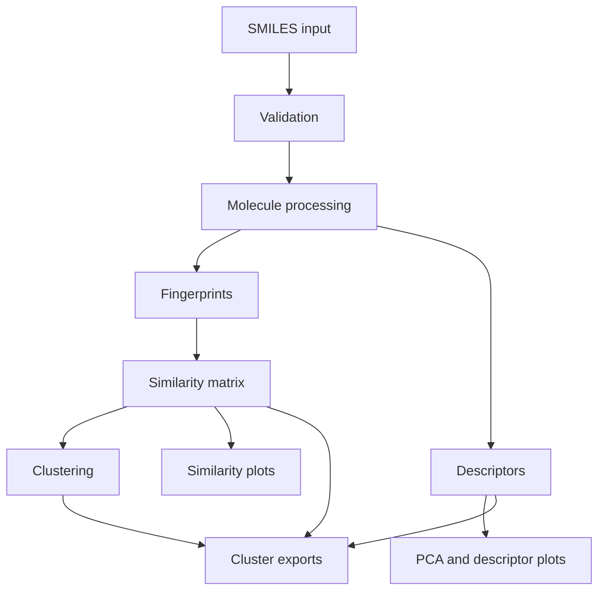

# Molecular Similarity & Clustering Tool

A Streamlit + RDKit application for validating SMILES strings, calculating molecular descriptors and fingerprints, computing pairwise Tanimoto similarity, clustering molecules, and exporting results.

## Scientific motivation

This project supports cheminformatics exploration of structural similarity. Computed similarity and cluster membership are analytical signals, not proof of equivalent chemical or biological behavior.

## Key features

- Manual and CSV SMILES input.
- Validation report with invalid-row tracking.
- Canonical and canonical isomeric SMILES generation.
- Duplicate detection using canonical isomeric SMILES.
- Morgan fingerprints (default radius 2, 2048 bits) and optional RDKit topological fingerprints.
- Required RDKit descriptor panel.
- Pairwise Tanimoto similarity matrix + ranked pair table.
- Agglomerative and Butina clustering.
- Heatmap, descriptor plots, similarity histogram, and PCA scatter.
- CSV exports for all major outputs.

## Technologies

Python, RDKit, Pandas, NumPy, Scikit-learn, Matplotlib, Seaborn, Streamlit, Pytest.

## Project structure

```text
molecular-similarity-clustering/
├── app.py
├── data_loader.py
├── molecule_processor.py
├── fingerprints.py
├── descriptors.py
├── similarity.py
├── clustering.py
├── visualization.py
├── utils.py
├── requirements.txt
├── README.md
├── LICENSE
├── .gitignore
├── data/
│   └── example_molecules.csv
├── tests/
│   ├── test_molecule_processor.py
│   ├── test_descriptors.py
│   ├── test_similarity.py
│   └── test_clustering.py
└── docs/
    └── methodology.md
```

## Setup

Recommended Python: **3.10+**.

```bash
python -m venv .venv
source .venv/bin/activate
pip install -r requirements.txt
```

## Run the app

```bash
streamlit run app.py
```

## Input format

Manual mode: one SMILES per line.

CSV mode: provide a SMILES column (default `SMILES`) and optional ID column.

## Descriptor notes

Includes: MolWt, ExactMolWt, MolLogP (calculated estimate), TPSA, H-bond donor/acceptor counts, rotatable bonds, heavy atoms, aromatic ring count, ring count, fraction sp3 carbons, and heteroatom count.

## Fingerprints and similarity

Morgan fingerprints encode local environments around atoms. Similarity is computed with Tanimoto:

\[
T(A,B) = \frac{c}{a+b-c}
\]

where `a` and `b` are active bits in each fingerprint and `c` is shared active bits.

## Clustering algorithms

- **Agglomerative**: distance matrix `D = 1 - T` with precomputed distances.
- **Butina**: RDKit distance-threshold clustering.

Thresholds are user-defined and context-dependent.

## PCA methodology and limitations

Descriptor features are median-imputed and standardized before PCA. PCA is a low-dimensional projection and may not preserve all molecular relationships.

## Example input

See `data/example_molecules.csv`.

## Testing

```bash
pytest -q
```

## Known limitations

- Similarity and clustering are structure-based and do not capture full chemical behavior.
- Canonical SMILES duplicate detection is representation-based and may not collapse all chemically equivalent forms (e.g., salts/tautomers depending on normalization choices).
- Very small datasets may not support meaningful clustering.

## Future ideas

- Add standardized salt/tautomer handling pipelines.
- Add scaffold-based analysis.
- Add 3D conformer-derived descriptors.

## Workflow diagram



## License

MIT. See `LICENSE`.
